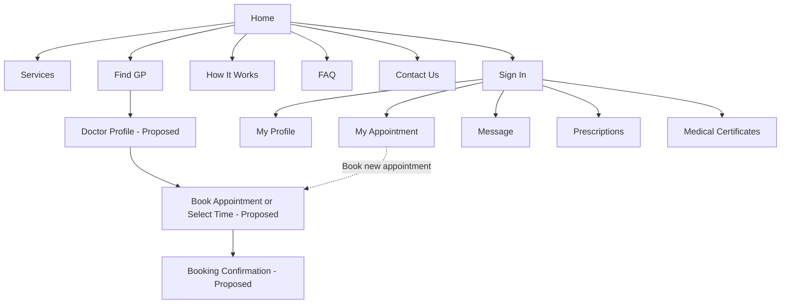

# Online GP Website Site Map Draft V1

## Confirmed pages

1. Home
2. Sign In
3. Services
4. Find GP
5. How It Works
6. FAQ
7. Contact Us
8. Message
9. Prescriptions
10. Medical Certificates
11. My Appointment
12. My Profile

## Proposed pages derived from Task 1

13. Doctor Profile
14. Book Appointment or Select Time
15. Booking Confirmation

The proposed pages require group confirmation before the Final Site Map is submitted.

## Draft hierarchy

## Finalisation checks

- Confirm every final prototype page appears in the Site Map.
- Confirm the primary parent of each page.
- Confirm which pages require sign-in.
- Confirm the three proposed booking-flow pages.
- Replace proposed labels after the group decision.
- Match the final page names and navigation exactly.

